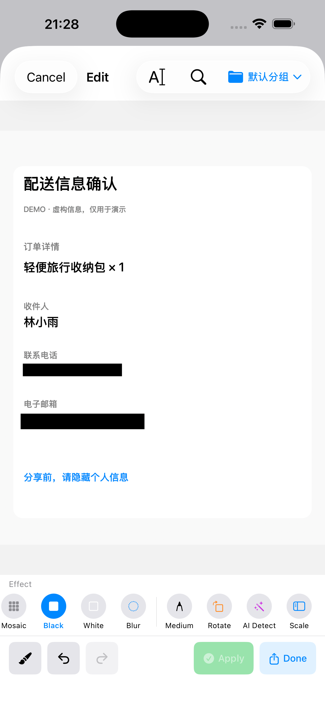
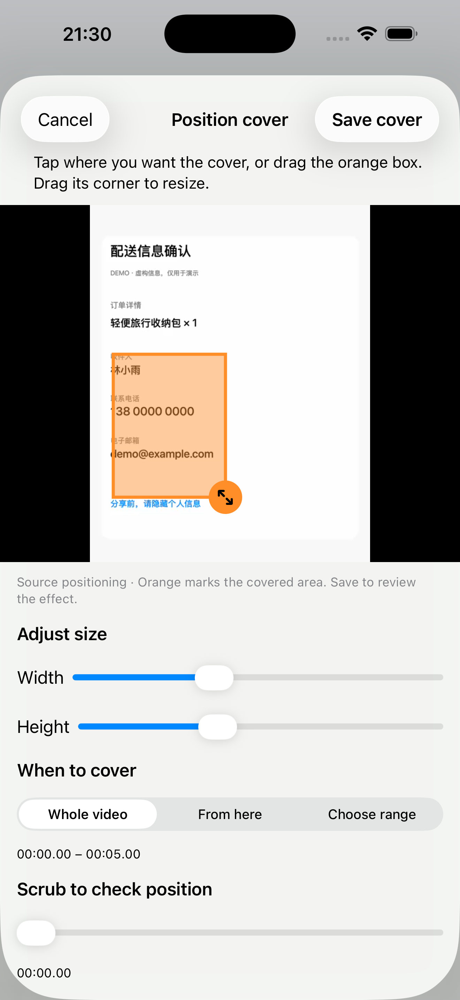
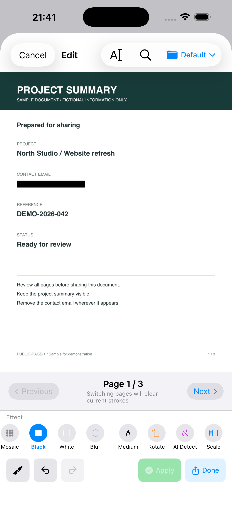

<div align="center">

# Cloakmark — formerly ZeroNet Redact

Cloakmark is listed on the App Store as **Video Blur: Cloakmark** (App Store ID **6756290503**). It is the same app previously named ZeroNet Redact; the repository name remains unchanged.

Cloakmark 的 App Store 名称为 **Video Blur: Cloakmark**（App Store ID **6756290503**），即原 ZeroNet Redact，仓库名称保持不变。

**Redact photos, videos and PDFs on your iPhone and iPad.**

**照片、视频、PDF，一处完成本地脱敏。**

[Download on the App Store](https://apps.apple.com/app/id6756290503) · [Website / 官网](https://zeronet-redact.materialofair.chatgpt.site/en/)

No account required · On-device processing · One-time upgrade, no subscription

[Product facts / 产品资料](docs/marketing/product-facts.md) · [Photo guide](https://zeronet-redact.materialofair.chatgpt.site/en/guides/redact-photos-iphone/) · [Video guide](https://zeronet-redact.materialofair.chatgpt.site/en/guides/redact-video-iphone/) · [PDF guide](https://zeronet-redact.materialofair.chatgpt.site/en/guides/redact-pdf-iphone/)

[English](#english) | [中文](#中文)

</div>

| Photos / 照片 | Videos / 视频 | PDFs / 文档 |
|:--:|:--:|:--:|
|  |  |  |

Actual app screens with fictional examples. The orange video box is an editing selection. / 真实应用截图，内容均为虚构示例；视频橙色框表示编辑选区。

---

## 中文

当前源码版本为 **1.5.5（26）**，保留发布脚本推进后的构建号。发布归档为 **1.5.5（25）**；两者区别和构建方式见 [版本与构建说明](docs/releases/1.5.5.md)。

v1.5 开发内容与验证记录见 [v1.5 开发交付说明](docs/v1.5-development-notes.md)，包括加密草稿、文字搜索、PDF 导航、系统分享导入与导出处理记录。

### 为什么做这个应用？

发送照片、视频或 PDF 前，先遮住不想公开的信息。Cloakmark 支持图片文字与人脸复核、视频指定区域和时段遮挡、PDF 敏感文字搜索与逐页处理，再导出副本用于分享。视频会先应用本地自动人脸轨迹，再叠加指定时段的手动区域。手动框位置固定；自动检测与轨迹关联可能遗漏或错配，请完整检查导出结果。

**文件内容在设备本地处理，无需上传原文件。自动检测可能遗漏信息，分享前请检查完整导出结果。**

### 核心理念

- **离线处理** — 脱敏操作无需网络；商品查询、购买和恢复购买可通过 Apple StoreKit 联网
- **本地处理** — 所有脱敏操作都在你的设备上完成，处理无需上传原始素材
- **隐私设计** — 处理无需应用账号；源码未集成广告或使用分析服务
- **开源透明** — 开源不是为了免费，而是为了让你可以验证我们的承诺，建立彼此的信任

### 功能特性

- 手势涂抹马赛克
- 矩形遮挡（黑条/白条）
- 高斯模糊
- 撤销/重做
- 加密存储原图
- 本地视频人脸检测与动态采样，支持强模糊与卡通贴纸遮挡；自动检测可能遗漏，请人工复核
- 视频时间区间手动补框、重画、逐段复核，以及用户确认的人物片段分组与统一效果
- 图片/PDF/视频加密草稿恢复；重复文字搜索、滑选文字与局部放大镜
- 图片批处理：统一识别规则、逐张复核、暂停恢复、失败重试，成功项在同批次中不重复导出
- PDF 待处理页面导航、图片/PDF 分享扩展及基于实际输出的处理记录
- 固定匿名男声、匿名女声、机器人和静音预设
- 视频原件认证分块加密，处理与换声完全离线
- 导出到相册或分享

### 系统要求

- iOS 17.6+
- iPhone / iPad

### 安装

从 [App Store](https://apps.apple.com/app/id6756290503) 下载，或访问[产品官网](https://zeronet-redact.materialofair.chatgpt.site/)。

免费版每天可导出 3 个 PDF，以及合计 3 个图片/视频；免费视频源文件上限为 300 MB。一次性内购可解除这些限制并解锁高级贴纸，无订阅。价格以当地 App Store 为准。

或克隆代码自行编译：

```bash
git clone --recurse-submodules https://github.com/materialofair/ZeroNet_Redact.git
cd ZeroNet_Redact/zeroNetRedact
open zeroNetRedact.xcodeproj
```

### 隐私政策

媒体在本地处理，无需上传原始素材。StoreKit 商品查询、购买和恢复购买可联网；导出副本未加密，系统分享、备份和外部目的地另有隐私影响。详见 [隐私政策](PRIVACY_POLICY.md)。

### 反馈与建议

如果你有任何问题或建议，欢迎通过 [GitHub Issues](https://github.com/materialofair/ZeroNet_Redact/issues) 与我们联系。

### 许可证

[GPL-3.0 License](LICENSE)

App 自身代码以 GPL-3.0 许可；二进制链接 MuPDF（AGPL-3.0）后按 AGPL-3.0
分发（GPLv3 §13），详见 [THIRD_PARTY_NOTICES.md](THIRD_PARTY_NOTICES.md)。

---

## English

Current source: **1.5.5 (26)**, preserving the build number advanced by the release script. The release archive was **1.5.5 (25)**. See [version and build notes](docs/releases/1.5.5.md).

### Why This App?

Hide a phone number in a photo, cover a private detail in a video, or redact text in a PDF. Cloakmark brings all three workflows together: import, review, cover, and export a copy. Video processing applies local automatic face trajectories first, then active manual regions. Manual covers stay in a fixed position. Detection and track association can miss or mismatch faces; review the entire export.

**Content is processed on your device without uploading your originals. Automatic detection can miss details; review the entire exported result before sharing.**

### Core Philosophy

- **Offline Processing** — Redaction works offline. Product queries, purchases and restores can connect through Apple StoreKit.
- **Local Processing** — All redaction happens on your device. Processing does not require uploading originals.
- **Privacy Design** — No app account needed for processing; the source does not integrate advertising or usage analytics services.
- **Open Source** — Open source isn't about being free—it's about letting you verify our promises and building mutual trust.

### Features

- Gesture-based mosaic drawing
- Rectangle masking (black/white bars)
- Gaussian blur
- Undo/Redo
- Encrypted storage for originals
- On-device video face detection with adaptive sampling, blur, or stickers; detection may miss content and requires review
- Manual timed rectangles with redraw, segment review, and user-confirmed person grouping with shared effects
- Encrypted image/PDF/video drafts; repeated-text search, swipe selection, and a magnifier
- Image batches with shared rules, per-image review, pause/resume, and retry without re-exporting successful items in the same batch
- Pending PDF page navigation, image/PDF share extension, and factual output processing reports
- Fixed anonymous male, anonymous female, robot, and mute voice presets
- Authenticated chunk encryption for source videos; processing and voice effects stay offline
- Export to Photos or Share

### Requirements

- iOS 17.6+
- iPhone / iPad

### Installation

Download from the [App Store](https://apps.apple.com/app/id6756290503) or visit the [product website](https://zeronet-redact.materialofair.chatgpt.site/en/).

Try 3 PDF exports and 3 combined photo/video exports per day for free. Free video exports support source files up to 300 MB. A one-time purchase removes these limits and unlocks premium stickers. No subscription; see your local App Store for pricing.

Or clone and build:

```bash
git clone --recurse-submodules https://github.com/materialofair/ZeroNet_Redact.git
cd ZeroNet_Redact/zeroNetRedact
open zeroNetRedact.xcodeproj
```

### Privacy Policy

Media is processed locally without requiring upload of originals. StoreKit product queries, purchases and restores can use the network. Exported copies are unencrypted; system sharing, backups and external destinations have separate privacy implications. See the [privacy policy](PRIVACY_POLICY.md).

### Feedback

If you have any questions or suggestions, feel free to reach out via [GitHub Issues](https://github.com/materialofair/ZeroNet_Redact/issues).

### License

[GPL-3.0 License](LICENSE)

The app's own source code is GPL-3.0; the distributed binary links MuPDF
(AGPL-3.0) and is therefore distributed under AGPL-3.0 (GPLv3 §13). See
[THIRD_PARTY_NOTICES.md](THIRD_PARTY_NOTICES.md).

---

<div align="center">

Made with privacy in mind.

</div>
